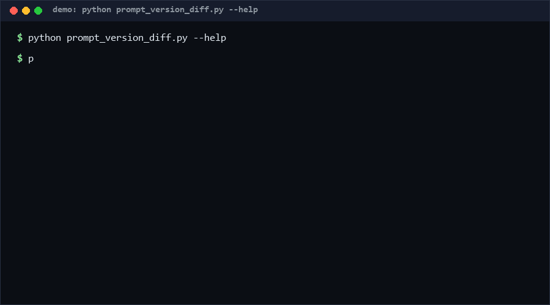

# prompt-version-diff

A structured diff for two versions of a prompt. Sections are classified as instruction / examples / constraints, changes are graded by severity (a constraint edit outranks an example swap), and semantic risks like "constraint removed" or "variables changed" are annotated. Single file, pure stdlib, no model calls.

**Status:** v0.1.1 · Confidence: high (structural diff), medium (keyword classification) · as of 2026-10-11

<p align="center"></p>

## Problem

`git diff` on a prompt file tells you *characters* changed, not *what kind* of thing changed. Reordering one example and deleting a hard constraint look identical there. Reviewers need a graded, structured view: which sections changed, how risky is each change, and did the variable surface shift.

## How it works

1. **Split**: both prompts are split into sections on markdown headings (`#`–`######`); text before the first heading is the preamble.
2. **Classify**: each section is tagged `instruction` / `examples` / `constraints` / `other` by keyword rules on title and body.
3. **Match & grade**: sections are matched by title; added/removed/modified changes get severity from their class (constraints → high, instruction → medium, examples/other → low) plus a `difflib` similarity score.
4. **Annotate**: risk notes for constraint edits/removals and `{variable}` additions/removals; exit code is `1` when max severity reaches `--fail-on` (default `high`).

## Quickstart

```bash
# ~0.5 s total [measured; reproduce: python self_test.py]
python self_test.py

python prompt_version_diff.py prompt_v1.md prompt_v2.md            # ~0.1 s, text report
python prompt_version_diff.py prompt_v1.md prompt_v2.md --json --fail-on medium
# exit 1 if any instruction-level or higher change exists
```

## Why not X

| Alternative | Stars | Why not this |
| --- | --- | --- |
| [openclaw-mcp-vps/prompt-version-diff-tool](https://github.com/openclaw-mcp-vps/prompt-version-diff-tool) | 0 ★ | Auto-generated generic tool with no section classification or severity grading; here every change is classed and risk-annotated. |
| `git diff` / `diff -u` | — | Pure character-level output; cannot distinguish a constraint deletion from a typo fix and has no exit-code severity gate. |
| LLM-based semantic diff | — | Judgement quality varies per model and per run; costs tokens. This is deterministic, free, and reviewable — at the cost of keyword-level classification only. |

## Minimal Fallback

If you cannot run this: keep prompts one-section-per-heading, and make reviewers eyeball headings, not lines: "did any *Constraints* heading change?" catches most real incidents.

## Design Trade-offs

- **Keyword classification, not a model** — deterministic and fast, but a constraint phrased without the usual keywords may be classed `other` (low severity). When in doubt, name your headings explicitly.
- **Title-based section matching** — renaming a heading reads as remove+add. Deliberate: renames usually *are* semantic changes.
- **Severity from class, not content semantics** — we cannot tell a tightened constraint from a loosened one; we only flag that a constraint changed.
- **No inline word-diff** — the report points at sections; use `git diff` for character detail.

## Limits & Second-order Effects

- Classification is English-keyword based; non-English prompts degrade to `other` unless titles carry the keywords (CJK titles like 任务 fall back too — see unicode tests).
- A "no changes" result means *structural* equality only; whitespace-insensitive semantic equivalence is not claimed.
- Second-order: teams may add constraint keywords to headings purely to game severity — acceptable, since it also makes prompts more readable.
- Very large prompts (>1 MB) slow the similarity computation; diff at section granularity is still linear-ish but not instant.

## FAQ

**When NOT to use this?**
When you need character-precise diffs (use git), when prompts have no heading structure at all and you cannot add any, or when you need guaranteed semantic classification of arbitrary prose — keywords cannot promise that.

**Does it need both files on disk?** Yes; pipe via process substitution if you prefer.

**Can I gate CI on medium changes?** `--fail-on medium` exits 1 for medium or high.

**Is the JSON stable?** Field names are stable within v0.1.x; new fields may be added.

## Core Assumptions

1. Prompts are (or can be) organized with markdown headings; classification quality depends on it.
2. Constraint changes are the highest-risk prompt edits and deserve the highest severity.
3. Variable-surface changes (`{var}` additions/removals) are always worth surfacing as risks.
4. Determinism beats cleverness: a slightly coarse but repeatable diff is more useful in CI than a smarter, flaky one.

## LICENSE

MIT — see [LICENSE](LICENSE). Copyright (c) 2026 zhengming contributors.
Contact: hcac4735@agent.qq.com

---

Part of the [zhengming-toolbox](https://github.com/chenhz01/zhengming-toolbox) — 55 purpose-built AI-engineering tools across neglected niches.

Related tools: [prompt-template-merge](https://github.com/chenhz01/prompt-template-merge) · [token-budget-clamp](https://github.com/chenhz01/token-budget-clamp) · [context-pack-planner](https://github.com/chenhz01/context-pack-planner)
